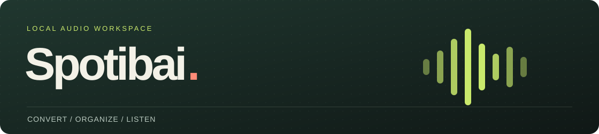
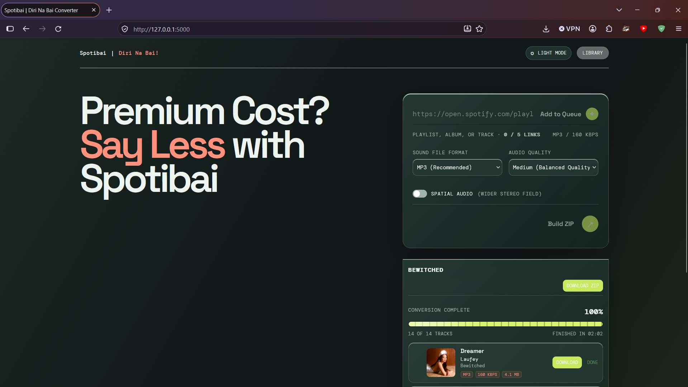
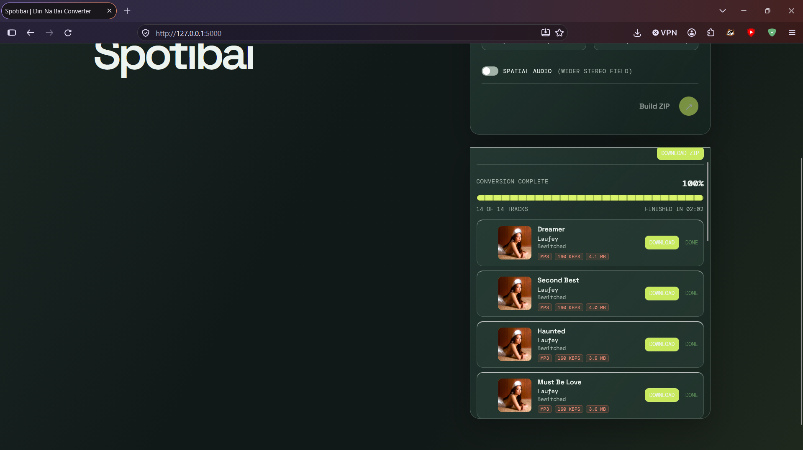
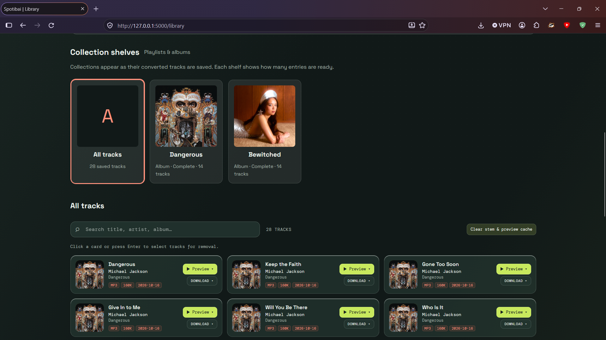

<h1 align="center">
  
</h1>

<p align="center">
  <strong>From a Spotify link to an organized local audio library.</strong><br>
  Convert playlists, albums, and individual tracks. Follow each song's progress, save a named ZIP, and preview your music from the Library.
</p>

<p align="center">
  <strong>Windows desktop setup</strong>
</p>

<p align="center">
  <a href="#quick-start">Get started</a> &nbsp; / &nbsp;
  <a href="#convert-your-first-collection">Convert a collection</a> &nbsp; / &nbsp;
  <a href="#your-library">Explore the Library</a>
</p>

<p align="center">
  <a href="docs/images/converter-overview.png">
    
  </a>
  <br>
</p>

## What you can do

| Feature | How it helps |
| :--- | :--- |
| **Verified collection queue** | Check the collection name and track count before adding up to five links. Playlists with 200 or more tracks show a confirmation. |
| **Progress for every song** | Follow Preparing, Downloading, Converting, and Finishing stages. Four workers process songs within the current collection. |
| **Named ZIP downloads** | Download each collection under its playlist or album name, or save individual finished tracks. |
| **Collection shelves** | Browse playlists and albums in the Library, see saved counts, and search within a selected shelf. |
| **Preview and separated audio** | Listen to originals, vocals, or instrumentals. Prepare and download stems directly from the Library. |
| **Guided desktop setup** | Check Python, install the audio requirements, and start the local app from one window. |

Spotify links provide metadata; spotDL locates audio sources and FFmpeg processes the output. Use Spotibai for music you own or have permission to download.

## Quick start

### 1. Open the launcher

Choose the option that matches your copy of Spotibai:

| You have | What to open |
| :--- | :--- |
| **A Windows ZIP package** | Extract the **entire ZIP** to a writable folder, then double-click **Spotibai.exe**. Keep the supporting files beside it. |
| **The source project** | Open the project folder and double-click **Start Spotibai.cmd**. |

The packaged setup window opens without Python preinstalled. It guides you through installing the separate Python environment used by the audio engine.

### 2. Complete the three setup steps

| Step | In the setup window |
| :---: | :--- |
| **01 · Python** | Let the launcher check your installation. If needed, choose **Install Python** and complete the guided installation. |
| **02 · Requirements** | Choose **Install or repair requirements**. Keep the window open while it prepares the Python packages, FFmpeg, and FFprobe. |
| **03 · Local app** | Choose **Start app**. Your browser opens when the local server is ready. |

First-time installation needs internet and can take several minutes. If setup fails, expand **Show setup details** for the error message.

### 3. Keep the launcher handy

Use **Open app** to return to the browser and **Stop app** to stop the server started by that window. When closing the launcher, you can stop the app or minimize the window to keep it running.

The default browser address is **http://127.0.0.1:5000**. If another program uses that port, the desktop launcher selects an available one and shows its address.

<details>
<summary><strong>Prefer terminal setup? Show the commands</strong></summary>

Run these from the source project folder with Python 3.11–3.13 available. Python 3.13 is recommended for this project.

```powershell
# Install the Python requirements and audio tools.
.\install.cmd

# Start the Python server.
.\.venv\Scripts\python.exe app.py
```

Then open http://127.0.0.1:5000. The setup script creates `.venv` and preserves a broken environment in `.venv-backup-*`.

For interpreter selection, manual installation, and the optional Node backend, see the [installation reference](docs/technical-reference.md#installation-details).

</details>

## Convert your first collection

1. **Paste a Spotify link.** Use a playlist, album, or individual track link.
2. **Check the title and track count.** Confirm the collection is the one you intended to add.
3. **Choose your output.** Select a file format and audio quality, then choose **Add to Queue**. Repeat for up to five distinct links.
4. **Choose Build ZIP.** Watch the current collection prepare and convert. Use its tabs or carousel controls to switch between queued collections.
5. **Save the finished audio.** Choose **Download ZIP** for the collection or **Download** beside an individual completed track.

| Output setting | Available options |
| :--- | :--- |
| **File format** | MP3, WAV, AAC, FLAC, ALAC |
| **Audio quality** | 96, 160, or 320 kbps, where supported by the selected codec |
| **Default selection** | MP3 / 160 kbps |
| **Spatial Audio** | Optional processing that widens the stereo field |

Collections run in queue order. Within the current collection, up to four songs run in parallel; the next collection waits for its turn.

<p align="center">
  <a href="docs/images/conversion-progress.png">
    
  </a>
  <br>
  <sub>Each song keeps its own title, artist, album artwork, format, and download control.</sub>
</p>

### If a track fails

Wait until every track in that collection has finished. Then choose **Retry failed** or the failed track's **Retry** button. Successful tracks stay available, and a completed retry refreshes the ZIP. You can also download a partial ZIP while keeping failed tracks available for a later retry.

## Your Library

Open **Library** from the converter to browse saved music, preview audio, and manage your collections.

<p align="center">
  <a href="docs/images/library-shelves.png">
    
  </a>
  <br>
  <sub>Collection shelves keep playlist and album downloads recognizable after conversion.</sub>
</p>

| Action | What to do |
| :--- | :--- |
| **Browse a collection** | Select a playlist or album shelf. Its count shows how many entries are saved; **Complete** means all entries are present. |
| **Search your music** | Search by title, artist, or album. When a shelf is selected, the search stays within it. |
| **Listen before downloading** | Open a track's **Preview** menu and choose **Original**, **Vocals**, or **Instrumental**. The player supports pause, replay, and switching sources. |
| **Download a version** | Open **Download** and choose the original or a prepared stem. Vocals and instrumental downloads live in the Library. |
| **Remove tracks** | Click a card to reveal checkboxes, select the tracks, then choose **Remove selected** and confirm. |
| **Clear generated audio** | Choose **Clear stem & preview cache**. The confirmation explains that originals stay saved and separated audio will need preparation again. |

Previews play up to seven seconds. A song shared by several saved collections can appear on each shelf while reusing its Library audio.

<details>
<summary><strong>Why are some tracks under Earlier downloads?</strong></summary>

Older downloads may have no recorded collection link. They remain available in **All tracks** and **Earlier downloads**. Convert the original playlist or album again to create its shelf; matching legacy tracks retain their Library IDs.

</details>

### Prepare vocals and instrumental

1. In the Library, find **Stem readiness** and choose **Run CPU & RAM test**.
2. Wait for the result. The test separates an eight-second generated sample and reports elapsed time, CPU time, peak RAM, and an estimated processing speed.
3. Open a track's **Preview** or **Download** menu and choose **Vocals** or **Instrumental**.
4. Follow preparation in the progress notification at the right edge. One separation prepares both versions, so the other stem can reuse the result.

The trial requires **2 GiB of available RAM** under the app's own readiness policy. It can be cancelled and stops after five minutes if unfinished. A slower CPU can pass; the result helps you judge the wait before preparing a full song. New stem work also checks the RAM available for that track.

Originals and already-prepared stems stay available without another test. The first preparation may download model weights. Full-song processing time varies with the computer, track length, and other running apps.

### Multitrack editing · Coming soon

The Library includes a concept preview for planned lead-vocal editing, chorus and backing-vocal layers, separate instrument lanes, and sound effects. Expand **Explore the concept** to read the proposed workflow. These editing tools are planned; current vocal and instrumental separation is available through the Library menus.

## Requirements at a glance

| Component | Requirement |
| :--- | :--- |
| **Desktop launcher and executable** | 64-bit Windows |
| **Audio runtime** | Python 3.11–3.13; the guided installer offers Python 3.13 |
| **Audio tools** | FFmpeg and FFprobe, installed by the setup script |
| **Connection** | Internet for first-time installation, Spotify metadata, audio sources, and the first model download |
| **Stem preparation** | A passing CPU/RAM test and enough current free RAM for the selected track |
| **Node.js** | Optional, for the alternative backend in the source project |

## Troubleshooting

| Problem | Next step |
| :--- | :--- |
| **“No matching distribution” during installation** | Use the project's supported Python version. Run `install.cmd` or **Install or repair requirements**, then start with `.venv\Scripts\python.exe`. |
| **The local page does not open** | Choose **Open app** and use the address shown in the launcher. Check **Show setup details** if the server stopped. |
| **A few tracks fail** | Let the collection finish, then manually retry the failed tracks. Successful downloads remain available. |
| **Vocals or instrumental needs preparation** | Run the Library's readiness test, then choose the stem from **Preview** or **Download**. |
| **The readiness test reports low RAM** | Close other apps and run the test again. Originals and existing prepared files remain usable. |
| **Network activity reads zero during encoding** | Local encoding and cached metadata can use no network. The display measures traffic across the computer, including other apps. |

For detailed cache behavior, performance settings, model processing, and setup diagnostics, read the [technical reference](docs/technical-reference.md).

## Development

With the project requirements installed, run the regression checks from the source folder:

```powershell
#Python backend and shared audio services
.\.venv\Scripts\python.exe -m unittest discover -s tests -v

#Frontend and optional Node backend
npm.cmd test
```

The regression suite simulates Spotify and audio download services; it does not download music.

<p align="center">
  <sub>Built with Flask, spotDL, FFmpeg, and Demucs. The optional Node backend shares the Python audio services.</sub><br>
  <a href="#quick-start">Back to setup</a> &nbsp; · &nbsp; <a href="docs/technical-reference.md">Technical reference</a>
</p>
